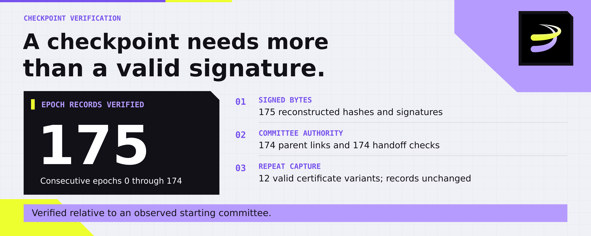
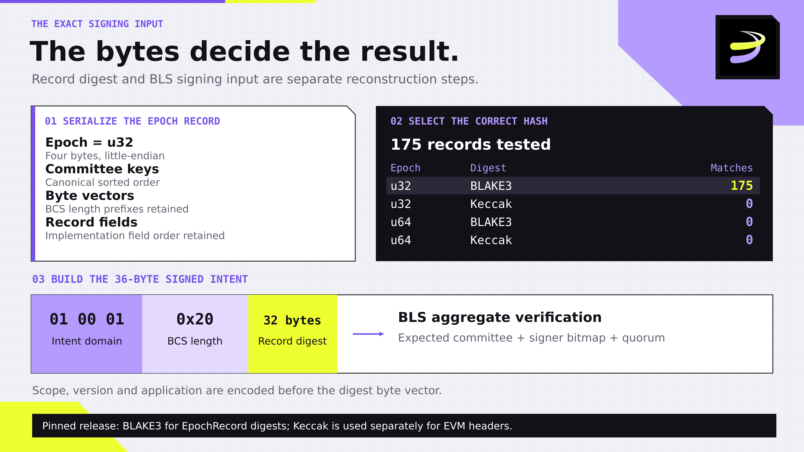
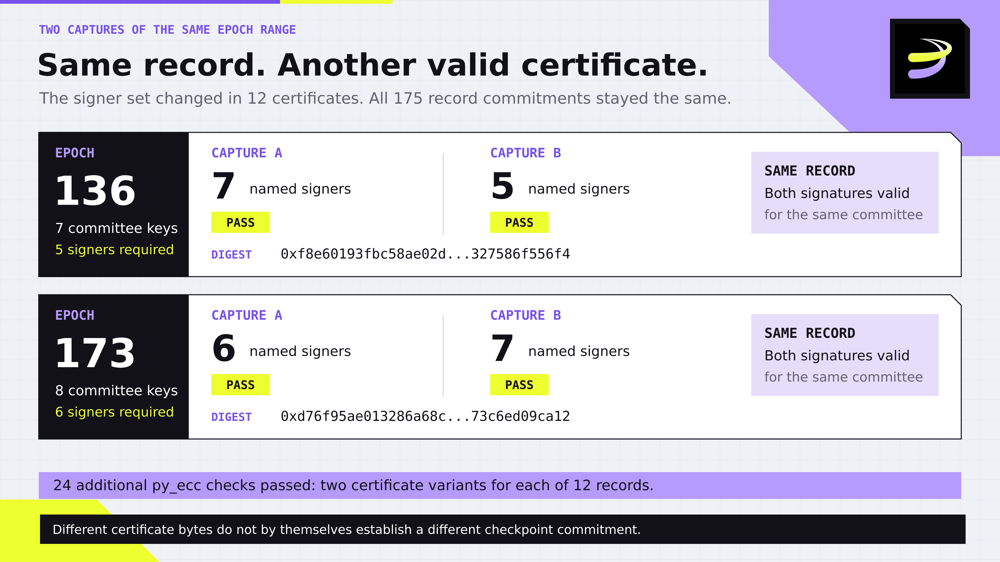
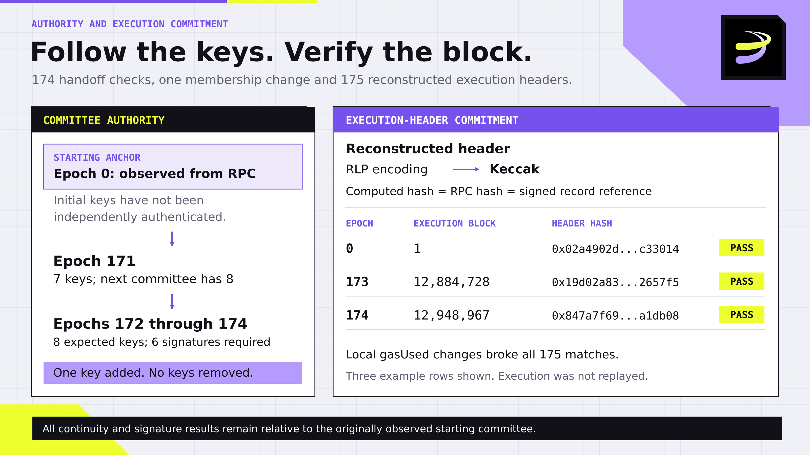

# How Can You Verify a Blockchain Checkpoint? Lessons from 175 Rayls Epoch Records

To verify a validator-signed blockchain checkpoint, check the exact data signed, a sufficient quorum of authorized keys, and the checkpoint's connection to a starting point you trust.

This study applied those checks to 175 consecutive Rayls mainnet epoch records, numbered 0 through 174. Every reconstructed record hash and aggregate signature passed. All 174 parent links and committee handoff checks also matched.

A repeat capture added another useful finding: 12 certificates returned different signer sets and aggregate signatures, while all 175 record commitments remained unchanged. Both versions of every certificate verified. A follow-up on 29 October extended the second-library check to all 187 distinct saved certificates and reconstructed all 175 referenced execution headers.

The starting committee was observed from the official RPC. The result is therefore a verified sequence relative to an explicitly recorded starting anchor. Independent authentication of that initial committee remains unresolved.

## What was checked

The original data was collected on 22 October 2026 from Rayls' documented mainnet RPC, which returned chain ID 72957. The same fixed epoch range was retrieved again on 23 October.

The endpoint advertised client version `1.4.1` and commit `6909618ba3d178884e613b329a99816ba546f62e`. The public `mainnet-v1.4.1` tag resolves to that commit, so the source analysis was pinned there. A version string helps align the analysis; it is not remote attestation of the running binary.

Rayls exposes an epoch record and its certificate through `rayls_epochRecord`. The record contains committee keys, the next committee, the previous record's hash, and references to execution and consensus checkpoints. Its certificate contains an aggregate BLS signature and a bitmap identifying the signers.

A separate Python verifier reconstructed the records and checked their signatures using `pyblst`. Axyl also uses blst, so this is a separate verification harness rather than a different underlying cryptographic implementation.

For a second implementation check, epochs 0, 173 and 174 from the original capture were verified using `py_ecc`. All three passed. The repeat-capture comparison later added 24 further checks with that library. The 29 October follow-up then checked every distinct certificate in both captures. No wallet or transaction submission was required.

## Reconstructing the exact signed record

The first useful finding appeared before signature verification.

The pinned release's RPC guide describes an `EpochRecord` digest using Keccak and lists the epoch field as `u64`. The implementation instead defines `Epoch` as `u32` and selects `blake3::Hasher` as its default hash function.

The source also determines the BCS binary serialization: field order, sorted committee keys and byte-vector length prefixes. These details change the bytes being hashed.

Following the implementation reproduced all 175 record hashes with BLAKE3. Applying Keccak to those same reconstructed bytes reproduced none. In additional offline comparisons, widening the epoch field to eight bytes also reproduced none, using either hash.

This is a documentation/implementation mismatch in the reviewed release. The captured records were consistent with the implementation. An integrator reproducing the digest needs the exact encoding and hash selection.

There is a further step before BLS verification. The certificate's signing input includes an intent domain; it is not the bare record digest. In this release, the reconstructed message is 36 bytes: three bytes for scope, version and application, a BCS length prefix, and the 32-byte digest. Its prefix is `01 00 01 20`, where hexadecimal `20` encodes the digest vector's length of 32 bytes.

The local controls rejected a wrong application domain and a message with the digest's length prefix removed. Reconstructing the record hash and reconstructing the signed message are separate tasks.

*Figure 1. The record encoding, digest selection and 36-byte BLS intent are separate reconstruction steps.*

## Following committee authority across epochs

A certificate identifies which keys signed. A verifier must also establish whether those keys belong to the expected committee.

For each record after epoch 0, the verifier checked two connections: `parent_hash` had to match the preceding record's digest, and the committee had to match that preceding record's `next_committee`.

All 174 parent links and all 174 committee handoff checks passed. Committee membership itself changed once.

Epochs 0 through 171 had seven committee keys. Epochs 172 through 174 had eight. One key was added and none were removed. The preceding record announced the same next committee that appeared in epoch 172.

For the pinned implementation's epoch-certificate rule, the required signer count is `floor(2*n/3)+1`: five signatures for seven keys and six for eight. In the 22 October capture, epoch 173 carried six signatures from its eight-key committee and met that threshold.

This count-based checkpoint rule should not be generalized to every voting-power rule elsewhere in Axyl. Eight keys also do not independently establish eight organizations, ownership groups or hosting providers. The records demonstrate a committee-key transition.

## A repeat capture changed certificates, not records

The 23 October capture retained the original observed starting anchor. All 175 epoch record objects and their digests matched the 22 October capture. Twelve certificates, however, carried different signer bitmaps and aggregate signatures.

Both variants passed verification against the unchanged record and its expected committee. Both variants for each of those 12 epochs were also checked using `py_ecc`: all 24 additional certificate checks passed. These concern 12 record commitments, not 24 new checkpoints.

At epoch 136, the original certificate named seven signers and the later capture named five. Both met the seven-key committee's five-signer threshold. At epoch 173, the observed count changed from six to seven, with both meeting the eight-key committee's six-signer requirement.

The distinction is between the record being authenticated and the certificate supplying that authentication. Comparing certificate bytes alone would report differences even though the signed checkpoint commitment was unchanged.

This repeat query does not establish why the endpoint returned different valid certificate variants. It does not establish conflicting checkpoint commitments, and using the same RPC again does not independently authenticate the starting committee.

*Figure 2. Capture A is 22 October and B is 23 October. Both variants authenticate the same respective record. Displayed hashes are abbreviated.*

## Checking what the verifier rejects

Valid records alone do not show whether a verifier catches broken inputs. The study therefore ran 13 local control cases: 12 expected rejections and one intentionally valid synthetic self-signature case.

Changing a checkpoint block hash caused a record-digest mismatch. Recomputing the digest after that alteration still failed because the retained signature did not authenticate the changed record.

Another case removed one claimed signer from epoch 174 while retaining its aggregate signature. Seven named signers would still exceed the six-of-eight threshold, but the signature check failed. Counting enough names does not prove that the signature matches those names.

The most instructive control used a locally generated one-key committee and a public test scalar. Its synthetic record had a mathematically valid signature and satisfied its own one-of-one threshold. It was rejected when the verifier required the committee announced by the actual preceding record.

These controls tested the separate offline verifier. They do not show that Rayls accepted a counterfeit checkpoint. No synthetic record or malformed control input was submitted to mainnet.

Signature mathematics, signer quorum and committee authorization are separate checks. A verifier needs all three.

## Testing authority across a complete synthetic chain

I added seven offline scenarios using three-record synthetic chains and public test scalars. Two were intentionally valid under their supplied synthetic anchors; five rejected at the expected stage.

The important controls kept individual signatures valid while changing another condition. A re-signed chain with a wrong parent link was rejected. A linked chain signed by an unannounced committee was rejected. A mathematically valid two-of-four aggregate failed the required three-of-four quorum.

A quorum-sized bitmap that did not match its aggregate failed the signature check. A valid chain also failed when its expected starting anchor differed.

Finally, an alternative synthetic chain passed when supplied with its own starting anchor. That is the trust boundary in executable form: a verifier can check consistency under supplied keys, but cannot establish where those keys came from through signature mathematics alone.

These seven scenarios exercise the offline research verifier. They are separate from the thirteen original controls, and no synthetic chain was submitted to Rayls.

## Connecting a signed record to an execution block

The study also checked three execution-block references: block 1, block 12,884,728 and block 12,948,967, associated with epoch records 0, 173 and 174 respectively.

For each sample, the block header was reconstructed, RLP-encoded and hashed with Keccak. The resulting hash matched both the RPC's reported block hash and the execution-block hash committed to by the signed epoch record. The repeat capture returned the same three block response objects.

Changing the local copy's `gasUsed` field broke that match in every sample.

This connects particular header contents to the signed checkpoint. It does not replay their transactions or independently validate every execution-state transition. BLAKE3 for these epoch records and Keccak for EVM block headers belong to different layers and must be kept distinct.

On 29 October, I extended header coverage to every block referenced by the original epoch range. All **175 reconstructed execution-header hashes** matched both the newly returned RPC block hash and the corresponding signed record reference. Changing the local gasUsed field broke all 175 matches.

The follow-up preserves the exact request and response bodies, timestamps, requested block numbers and calculated hashes. These new observations came from the same documented RPC. They extend header coverage; they do not independently authenticate the initial committee or replay transaction execution.

*Figure 3. All 175 referenced headers were verified in the follow-up; three illustrative rows are shown. Verification remains relative to the observed starting committee. Transaction execution was not replayed.*

## Where the initial trust remains

The epoch-0 record and committee came from the same official RPC as the later records. Their exact values are preserved in `OBSERVED_ANCHOR.json`, but an independently authenticated starting committee was not established.

The result therefore supports signature validity and continuity relative to that observed anchor. Chain ID, a version string and repeated queries to the same endpoint do not independently authenticate the initial keys.

For a reader building a verifier, the next step is to obtain a trusted genesis committee or checkpoint through an authenticated source, then apply the continuity checks from there.

For an institution assessing settlement evidence, a checkpoint certificate authenticates a commitment under specified keys and assumptions. This study does not establish end-to-end bridge settlement, throughput, sub-second latency or a named bank's production configuration.

## Reproducing the study and the follow-up

The public evidence repository is [david-rayls-checkpoint-study](https://github.com/davidvnvn276/david-rayls-checkpoint-study).

The reviewed distribution preserves the original 121-file publication archive unchanged. Its follow-up adds the complete second-library results, 175-header capture, seven synthetic-chain fixtures, source-identity checks, executable programs and updated figures.

After installing the pinned dependencies with `python -m pip install -r requirements-lock.txt`, run `python verify_study.py --output runs/first-run` from the extracted reviewed study root. The README gives separate Linux and Windows commands, expected outputs, log paths and failure diagnosis.

The launcher verifies integrity, runs the original ten-step audit, checks all distinct certificates with py_ecc, verifies the 175 captured headers and checks article/figure consistency. Fresh outputs go into a new directory. The distributed observations remain unchanged.

The complete second-library review covers **187 distinct certificates across 350 saved observations of 175 record commitments**. Identical certificates are checked once and mapped back to both captures. These are coverage counts, not additional independent checkpoints or experiments. All 187 checks passed.

The original capture was 22 October and the repeat was 23 October. The complete second-library review, new header capture and synthetic-chain controls were performed on 29 October. The recorded environment was Linux with Python 3.12.14; native Windows and macOS execution were not tested.

The default audit works offline after dependency installation. A separate explicit capture option makes fresh read-only RPC requests. Neither route signs or submits transactions. An included CI workflow can repeat the saved-data audit; its actual run and commit must be checked before claiming a public CI pass.

The main result remains precise: **the captured Rayls epoch records form a valid signed sequence under the recorded starting committee, and all 175 referenced execution headers match their signed commitments.** Different valid certificates can authenticate an unchanged record. A useful checkpoint verifier must reconstruct the signed bytes, verify the authorized quorum and make its starting trust assumption visible.

## Sources

- [Rayls Public Chain reference: official RPC and chain ID](https://docs.rayls.com/docs/public-chain-reference)
- [Axyl technical specification: epoch records and certificates](https://docs.rayls.com/docs/about-the-axyl-consensus-algorithm)
- [Pinned EpochRecord implementation: fields, digest and quorum](https://github.com/raylsnetwork/axyl/blob/6909618ba3d178884e613b329a99816ba546f62e/crates/infrastructure/types/src/primary/epoch.rs)
- [Pinned committee types: Epoch definition](https://github.com/raylsnetwork/axyl/blob/6909618ba3d178884e613b329a99816ba546f62e/crates/infrastructure/types/src/committee.rs)
- [Pinned hash selection: BLAKE3](https://github.com/raylsnetwork/axyl/blob/6909618ba3d178884e613b329a99816ba546f62e/crates/infrastructure/types/src/crypto/mod.rs)
- [Pinned RPC guide: description reconciled with the implementation](https://github.com/raylsnetwork/axyl/blob/6909618ba3d178884e613b329a99816ba546f62e/doc/crates/execution/rpc.md)
- [Pinned BCS codec](https://github.com/raylsnetwork/axyl/blob/6909618ba3d178884e613b329a99816ba546f62e/crates/infrastructure/types/src/codec.rs), [intent domain](https://github.com/raylsnetwork/axyl/blob/6909618ba3d178884e613b329a99816ba546f62e/crates/infrastructure/types/src/crypto/intent.rs) and [BLS signature verification](https://github.com/raylsnetwork/axyl/blob/6909618ba3d178884e613b329a99816ba546f62e/crates/infrastructure/types/src/crypto/bls_signature.rs)
- [pyblst](https://github.com/OpShin/pyblst) and [py_ecc](https://github.com/ethereum/py_ecc): verification-library sources
